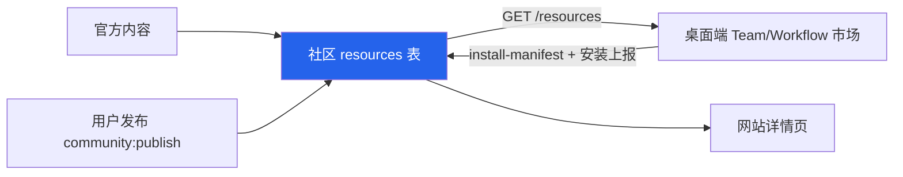

# 06 · 社区定位为 SpectrAI 内容后台：一期方案

> 日期：2026-10-03 · 状态：待确认
> 范围：只做 Workflow + Team 两类内容；论坛、悬赏、CDK、徽章、Showcase 原样保留，不下线、不投入。

## 1. 定位

社区 = **SpectrAI 的内容后台**。桌面端的市场从社区拉内容，官方在社区上架/更新，桌面端不用发版就能上新；网站只是附带的展示/分享出口。

## 2. 硬约束

- 桌面端在用的接口一个字段都不改：`/auth/claudeops/link`、`/credits/*`、`/promoter/*`、`/spectrAI/plan|quota/*`、`/resources/:id/install-manifest`。
- 不改 `claudeops://install/{type}/{id}` 协议，不改 `community:publish` IPC。
- 只做**新增**：新接口、新 IPC 通道、新 tab。
- 一期不改数据库 schema。

## 3. P0 · 备内容（只动社区仓库和线上数据，桌面端不改）

### P0-1 同步服务器补丁回仓库

7/31 在服务器 `/opt/spectrai-community` 上直接改过、没提交的两处：

| 文件 | 改动 |
|---|---|
| `apps/web/package.json` | Next 升到 15.2.9 |
| `apps/web/Dockerfile` | 删除容器里的 curl / wget / nc |

做法：从服务器 scp 回来 → 本地 diff 确认 → 提交。顺手删掉根目录的临时脚本 `p05-*`、`p05_apply.py`、`p17*`。

### P0-2 清理种子假数据

- `apps/api/src/db/seed.ts` 里的种子作者（`alice-dev` / `bob-builder` / `charlie-ai`）名下的资源，在线上改为 `is_published=false`（**下架，不删**，可回滚），`downloads` 不再展示。
- 其余真实用户发布的资源保留；操作前先导出一份 `resources` 表备份。
- 先跑 SELECT 列出待下架清单给你过目，确认后再执行 UPDATE。

### P0-3 建「SpectrAI 官方」账号

- 在 `users` 表建一个官方账号，作为官方内容的 `author_id`，前端显示「SpectrAI 官方」。
- 不加 `is_official` 字段：一期用「官方账号 + `tags` 含 `official`」区分即可。（ponytail：要做认证作者体系时再加字段。）

### P0-4 导入内置内容（一次性脚本）

| 来源 | 数量 | 社区类型 | 转换要点 |
|---|---|---|---|
| `src/main/orchestrator/builtinWorkflows.ts` | 9 套 | `workflow` | 结构基本直接对应，去掉 `builtin-` 前缀的 id |
| `src/main/team/assets/BuiltinTeamAssets.ts` | 11 套模板（引用 23 个角色预设） | `team` | 按 `roleKey` 把角色预设的 systemPrompt 内联进 `roles[]`，满足 `adaptContentForDesktop` 的字段要求 |

- 脚本放在 `apps/api/src/db/import-builtin.ts`，从 claudeops 仓库读源文件生成 JSON，再走管理员接口写入，`review_status=approved`、`is_published=true`。
- 幂等：按「官方账号 + name」判重，重复跑只更新不新增。
- 验收：每一条都用桌面端 `claudeops://install/...` 实装一遍，能装上、能运行才算上架成功。

### P0-5 上架你自己跑通的流程（人工）

从你在用的流程里挑 5～10 套（如视频发布流水线、52pojie / V2EX / HN 巡检）：去掉本机路径、密钥、open_id 等隐私信息后，用桌面端「发布到社区」走正常发布流程。

**P0 完成标准**：社区里有 25～30 条真正能一键装上的官方 Workflow/Team，没有假数据。

## 4. P1 · 打通桌面端（新增通道，不改现有协议）

### P1-1 社区侧：安装上报接口

现状：`install-manifest` 不增加下载数，只有 `GET /resources/:id` 增加，所以桌面端装了也不计数，排行榜是失真的。

- 新增 `POST /api/resources/:id/installs`：`optionalAuth`，`downloads + 1`。
- 防刷：Redis 按 `IP + 资源 id` 24 小时去重（项目已有 `lib/redis.ts`）。
- 补一条 vitest。

### P1-2 桌面端：主进程新增读取通道

- 新增 IPC `community:listResources({ type, sort, q, page })` → 转发 `GET {COMMUNITY_API_BASE}/resources`，主进程侧加 5 分钟内存缓存，失败时返回空列表，不能影响本地内置内容。
- 安装直接复用现有的 `handleDeepLinkUrl(installUrl)`（`src/main/ipc/deepLinkHandlers.ts`），装成功后 fire-and-forget 调一次 P1-1 的上报接口。

### P1-3 桌面端：UI 加「社区」tab

| 位置 | 改动 |
|---|---|
| `src/renderer/components/teams/TeamGallery.tsx` | 加「社区」tab，列表 + 安装按钮 |
| Workflow 模板选择处 | 同上 |

本地内置内容保持不动、照常可用，社区 tab 只是新增的来源。离线或接口失败时 tab 显示空态，不报错。

### P1-4 入口

- 官网 `release/web/` 首页/下载页加「社区」链接。
- 社区网站的资源详情页「在 SpectrAI 中安装」按钮已经存在，核对一下能不能正常拉起桌面端。

**P1 完成标准**：桌面端能浏览并一键安装社区里的 Workflow/Team，安装量真实写进 `downloads`。

## 5. P2 · 跑 2～4 周看数据，再决定

观察指标（直接查线上库）：

| 指标 | 来源 |
|---|---|
| 社区 tab 安装次数 / 每条资源安装量 | `resources.downloads` |
| 用户发布量 | `resources` 中 `source_app='desktop'` 的新增 |
| 网站详情页到安装的转化 | Nginx 日志 |

根据数据决定是否做：

1. 专家、生图提示词、定时任务模板接入社区（要新增 `resourceTypeEnum` 和 deep link 类型，属于协议变更，需要单独评审）。
2. 外部 MCP / Skill 精选：只加中文简介和标签，安装仍走桌面端现有的 Registry / skills.sh 直连，社区不做镜像。
3. 发布者积分激励（复用现有的 `credit-service`）。
4. 网站重做到什么程度（`ignoreBuildErrors`、纯客户端渲染、OAuth TODO、假上传等问题届时一起处理）。

## 6. 明确不做（一期）

- 不改账号体系，也不动 PHP `api/` 和社区之间会员回写的边界。
- 不重构网站 UI。
- 不碰论坛、悬赏、CDK、徽章、Showcase。
- 不新增资源类型。

## 7. 改动清单与工作量

| 编号 | 仓库 | 改动 | 估计 |
|---|---|---|---|
| P0-1 | community | 两个文件同步 + 删临时脚本 | 0.5h |
| P0-2/3 | 线上库 | SELECT 清单 → 确认 → UPDATE / INSERT | 1h |
| P0-4 | community | 导入脚本 + 逐条实装验收 | 0.5～1d |
| P0-5 | — | 人工脱敏发布 | 你的时间 |
| P1-1 | community | 1 个接口 + 测试 | 2h |
| P1-2/3 | claudeops | 1 个 IPC + 2 个 tab | 1d |
| P1-4 | claudeops `release/web/` | 加链接 | 0.5h |

## 8. 风险

- **桌面端旧版本**：P1 是纯新增，旧版本照常可用，只是看不到社区 tab。
- **内置模板与社区版本不一致**：一期内置内容照旧随桌面端发版，社区版是副本；以后要「社区为准」再做同步机制。
- **线上数据操作**：P0-2/3 全部先备份、先出清单，确认后再执行。
